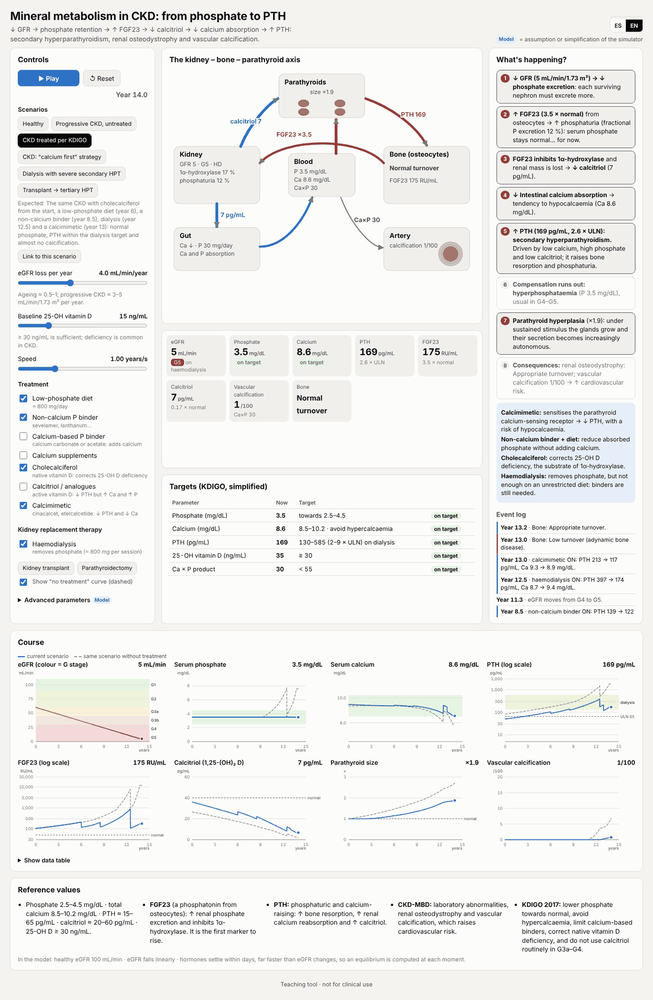

# CKD-MBD: from phosphate to PTH

**Live demo:** https://ferasmed-dev.github.io/ckd-mbd/ · English: https://ferasmed-dev.github.io/ckd-mbd/?lang=en

An interactive teaching simulator of **chronic kidney disease–mineral and bone disorder (CKD-MBD)**. As eGFR falls over the years you watch the whole cascade unfold: phosphate retention → **FGF23** rises first → **calcitriol** falls → less calcium absorption → **secondary hyperparathyroidism** → parathyroid hyperplasia → renal osteodystrophy and **vascular calcification**. Then you treat it: diet, phosphate binders, nutritional or active vitamin D, calcimimetics, dialysis, parathyroidectomy and kidney transplantation.

Interface in Spanish (default) and English. No build step, no dependencies, runs from any static host.



> **Teaching tool · not for clinical use.** The model is a qualitative, semi-quantitative caricature built to show directions, sequence and trade-offs, not to predict a patient's values.

## What it shows

- **The order of events.** FGF23 rises from early CKD (G2–G3a) while serum phosphate is still normal, because each surviving nephron raises its fractional phosphate excretion. PTH rises from G3, and hyperphosphataemia only appears in G4–G5 once fractional excretion can rise no further.
- **The kidney–bone–parathyroid axis** as a live schematic: arrows thicken and change colour with FGF23, calcitriol, PTH, calcium absorption and the Ca × P product.
- **Gland hyperplasia over years.** A sustained stimulus enlarges the parathyroids, and the larger gland keeps secreting. A transplant fixes the kidney but not the glands, which unmasks **tertiary hyperparathyroidism** (high PTH with high calcium).
- **Treatment trade-offs**, KDIGO 2017-style: non-calcium binders and diet lower phosphate without a calcium load; calcium-based binders, calcium supplements and calcitriol suppress PTH but raise calcium, push turnover towards **adynamic bone** and accelerate **vascular calcification**; calcimimetics lower PTH and calcium; parathyroidectomy produces a "hungry bone" drop in calcium.
- **"¿Qué está pasando?" / "What's happening?"**: eight numbered steps light up as each one happens, with the live values, plus notes for every active treatment and an event log.
- **KDIGO targets table** (simplified), tiles with live values, and eight synced charts with a dashed **"no treatment" counterfactual** and a data-table view.

## Curriculum fit

For students and teachers at **any Spanish medical faculty**. The topic belongs to the national common core (Orden ECI/332/2008), whatever the subject is called locally:

| | |
|---|---|
| **Modules** | I (Morfología, estructura y función: calcium–phosphate physiology, PTH, vitamin D, FGF23) · III (Formación clínica humana: CKD and its complications) · IV (Procedimientos diagnósticos y terapéuticos: binders, vitamin D, calcimimetics, dialysis, parathyroidectomy) |
| **Typical subjects** | Fisiología · Fisiopatología · Patología médica / Nefrología · Endocrinología · Farmacología |
| **MIR** | Yes. CKD complications, secondary vs tertiary hyperparathyroidism, renal osteodystrophy and binder choice come up regularly. |

Topic metadata for catalogues lives in [`curriculum.json`](curriculum.json).

## For teachers

Every scenario has a deep link you can project or share. Add `&lang=en` for English.

| Scenario | Link |
|---|---|
| Healthy | https://ferasmed-dev.github.io/ckd-mbd/?preset=healthy |
| Progressive CKD, untreated | https://ferasmed-dev.github.io/ckd-mbd/?preset=ckdUntreated |
| CKD treated per KDIGO | https://ferasmed-dev.github.io/ckd-mbd/?preset=ckdGuideline |
| CKD: "calcium first" strategy | https://ferasmed-dev.github.io/ckd-mbd/?preset=calciumFirst |
| Dialysis with severe secondary HPT | https://ferasmed-dev.github.io/ckd-mbd/?preset=dialysisSevereHPT |
| Transplant → tertiary HPT | https://ferasmed-dev.github.io/ckd-mbd/?preset=transplantTertiary |

Suggested sequence for a class: run *untreated* and ask which marker moves first; compare *KDIGO* with *calcium first* (same patient, same years) and look at calcium, bone and calcification; finish with *transplant* to show why a normal kidney does not normalise PTH.

## Model

Hormones and serum levels settle within days, much faster than eGFR changes, so at each time step (0.02 years) the model solves a **quasi-steady state** of mineral metabolism for the current eGFR and gland mass. Only three things evolve slowly: **eGFR**, **parathyroid gland mass G** and the **calcification score**.

### Fast (steady-state) part — `mineral(p, eGFR, G)`

Solved by fixed-point iteration (calcitriol ↔ PTH):

```
GFR (dL/day)        = eGFR × 14.4
Absorbed P load     = max(30, intake × (0.55 + 0.1·min(2.5, calcitriol/40)) × binders − dialysis 340)   mg/day
FEP needed          = load / (GFR × 3.5)               (fractional excretion to keep P at 3.5 mg/dL)
FEP                 = clamp(FEP needed, 0.03, 0.60)
P                   = load / (GFR × FEP)                 → stays 3.5 until FEP hits its 60 % ceiling
FGF23               = 50 · max(1, FEP needed/0.155)^1.5 · max(1, P/4.5)^2 · max(1, 30/eGFR)^0.7
calcitriol (endog.) = 40 · min(1, eGFR/60)^0.7 · √min(1.1, 25-OH D/30) · (50/FGF23)^0.25 · (PTH/40)^0.15   (+30 if calcitriol given)
Ca before PTH       = 9.5 + ln(calcitriol/40) − 0.12·max(0, P − 3.5) + 0.5 Ca binder + 0.4 Ca supplement + 0.6 dialysis
PTH needed          = 40 · (1 + 2·max(0, 9.5 − Ca₀)) · e^(−1.5·max(0, Ca₀ − 9.5)) · (P/3.5)^0.6 · (calcitriol/40)^−0.3
secretion ratio     = G^0.6 × (0.5 with calcimimetic)
PTH                 = PTH needed × ratio
efficacy            = min(1, (eGFR/60)^0.3)               (skeletal resistance to PTH in advanced CKD)
Ca                  = Ca₀ + efficacy · (0.6·(9.5 − Ca₀)·min(1, ratio) + 1.3·ln(max(1, ratio)))
```

The last line says: normal-sized glands correct 60 % of a calcium deficit; glands larger than the stimulus requires (ratio > 1, autonomous secretion) push calcium above normal — tertiary hyperparathyroidism.

### Slow part — `step(state, p, dt)`

```
eGFR(t + dt) = max(5, eGFR − slope·dt)
dG/dt        = 0.2 · ln(max(1, stimulus/1.5)) · (1 − G/Gmax) − 0.05 · (G − 1)
               stimulus = PTH needed/40 (× 0.6 with calcimimetic); Gmax = 6, or 1.2 after parathyroidectomy
dCAC/dt      = 2 · max(0, (Ca·P − 40)/10) + 1.5 · calcium load + 0.5 dialysis     (only accumulates; cap 100)
               calcium load = Ca binder 1 + Ca supplement 0.7 + calcitriol 0.7
```

**Bone turnover** (renal osteodystrophy, shown in G4–G5/dialysis): PTH > 9 × ULN → high turnover (osteitis fibrosa); PTH < 2 × ULN on dialysis or eGFR < 15 → low turnover (adynamic bone); otherwise appropriate.

### Parameters

| Parameter | Value | Basis |
|---|---|---|
| Healthy eGFR / decline | 100 mL/min/1.73 m², 0.5 per year | Physiology (ageing ≈ 0.5–1/year) |
| Progressive CKD decline | 4 mL/min/1.73 m² per year | Clinical range for progressive CKD (≈ 3–5) |
| Serum phosphate set point | 3.5 mg/dL (normal 2.5–4.5) | Physiology |
| Total calcium set point | 9.5 mg/dL (normal 8.5–10.2) | Physiology |
| PTH normal / ULN | 40 / 65 pg/mL | Typical intact-PTH assay |
| Dialysis PTH target | 130–585 pg/mL (2–9 × ULN) | KDIGO 2017 |
| FGF23 normal | 50 RU/mL | C-terminal assay, typical normal |
| Calcitriol normal | 40 pg/mL (≈ 20–60) | Physiology |
| 25-OH vitamin D | 30 ng/mL replete; 15 in the CKD presets; colecalciferol → ≥ 35 | Physiology; deficiency common in CKD |
| Dietary phosphate | 1200 mg/day; 800 with restriction | Typical Western diet; usual restriction |
| Fractional excretion of P | 15.5 % normal, maximum 60 % | Physiology (normal ≈ 5–20 %); ceiling is a **tuning assumption** |
| Dialysis phosphate removal | 340 mg/day (≈ 800 mg per session × 3/week) | Conventional haemodialysis |
| Dialysate calcium effect | +0.6 mg/dL | **Tuning assumption** (dialysate Ca 2.5 mEq/L) |
| Binder effect | −30 % absorbed P per binder | **Tuning assumption** |
| Gland growth / max / regression | 0.2 / 6 × / 0.05 per year | **Tuning assumptions** (nodular hyperplasia regresses slowly) |
| Calcification rate | 2 per 10 units of Ca × P above 40 per year | **Tuning assumption** (Ca × P < 55 is the classic threshold) |

### Known simplifications

- Calcium and phosphate are single compartments; no ionised calcium, albumin correction, magnesium, acid–base or bicarbonate.
- Hormones are steady-state at each step; acute dynamics (e.g. the post-dialysis rebound) are not modelled.
- eGFR declines linearly; no AKI episodes, proteinuria or RAAS effects.
- The calcification score and bone-turnover label are qualitative; they are not Agatston scores or histology.
- Calcimimetics are modelled as halving secretion per gland mass and slowing hyperplasia; etelcalcetide and cinacalcet are not distinguished.
- Treatments are on/off with fixed doses.

## Presets and expected results

All values from `simulatePreset()` (rounded). The UI reproduces these trajectories exactly (checked automatically, see below).

| Preset | Setup | Expected |
|---|---|---|
| `healthy` | eGFR 100, 25-OH D 30 | Everything stays normal: P 3.5, Ca 9.5, PTH ≈ 40, FGF23 ≈ 50–56 over 15 years |
| `ckdUntreated` | eGFR 60, −4/year, 25-OH D 15; haemodialysis at year 12.5 | FGF23 doubles by year 6 (201) while P stays 3.5; PTH 172 at year 6, 235 at year 8 (G4); P > 4.5 only after year 10; at year 12.4 (eGFR 10): P 7.5, Ca 8.1, PTH ≈ 1375, FGF23 ≈ 6900, glands × 2.4, high-turnover bone; dialysis alone does not control P (year 15: P 7.6, PTH ≈ 1870) |
| `ckdGuideline` | Same + colecalciferol; low-P diet year 6; non-Ca binder year 8.5; dialysis year 12.5; calcimimetic year 13 | P stays ≤ 3.7; PTH 125 at year 8, 371 just before dialysis, 172 at year 15 (inside 130–585); calcification ≈ 1/100; bone appropriate |
| `calciumFirst` | Same CKD + calcium supplements; calcitriol year 6; Ca binder year 8.5; dialysis year 12.5 | PTH suppressed (25 at year 8, 9 at year 15), Ca rises to 10.4, **adynamic bone** from G5, calcification ≈ 28/100 at year 12.4 and ≈ 40/100 at year 15 |
| `dialysisSevereHPT` | On dialysis, 25-OH D 15, glands × 4; year 1: non-Ca binder + colecalciferol + calcimimetic; year 4: parathyroidectomy | PTH ≈ 1620 and P 6.3 at start → 293 by year 3.9; after surgery Ca drops to 8.2 and PTH ≈ 107 (transient low turnover), then the remnant regrows (× 1.1) and PTH settles ≈ 285 |
| `transplantTertiary` | On dialysis, glands × 5, PTH ≈ 1830; transplant at year 2 (eGFR 60, −1/year) | After transplant P normalises (3.5) but PTH stays ≈ 180 with **Ca 10.5–10.6** (tertiary HPT); glands shrink slowly (× 4.8 → × 3.2 at year 15), Ca still 10.1 at year 15 |

## Layout

```
index.html              page and controls
src/model.js            pure model: steady state, step, classification, presets (no DOM)
src/ui.js               UI loop, schematic, explanations, log; exposes window.__sim for automated checks
src/charts.js           dependency-free SVG line charts (log scale, bands, counterfactual, crosshair)
src/i18n.js             Spanish and English strings
src/styles.css          light/dark styles
tests/model.test.js     node:test unit tests
curriculum.json         topic metadata
docs/screenshot.png
```

URL parameters: `?lang=es|en` (remembered in localStorage) and `?preset=<key>`.

## Run locally

ES modules need a server (opening the file directly will not work):

```bash
python3 -m http.server 8000
# open http://localhost:8000/
```

## Tests

```bash
npm test        # = node --test
```

15 tests cover healthy steady state, the order of the cascade (FGF23 before phosphate), monotonic directions, FGF23 inhibiting calcitriol, each treatment's direction, extreme inputs (finite, non-negative), calcification never decreasing, G staging boundaries, every preset's expected behaviour and purity of the model functions. GitHub Actions runs them on every push.

Beyond the unit tests, every preset was run in the browser (Spanish and English) and compared with `simulatePreset()` at 11 time points away from event instants (66/66 match per language), plus checks for console errors, untranslated keys, language switching mid-run, real-time playback, the transplant and parathyroidectomy buttons and every `?preset=` deep link.

## Deploy (GitHub Pages)

1. Push this folder's contents to a public repository named `ckd-mbd` (files at the root).
2. Settings → Pages → Build and deployment → Deploy from a branch → `main` / `(root)` → Save.
3. After 1–2 minutes the site is at `https://ferasmed-dev.github.io/ckd-mbd/`.

## References

- KDIGO 2017 Clinical Practice Guideline Update for the Diagnosis, Evaluation, Prevention, and Treatment of CKD-MBD. *Kidney Int Suppl.* 2017;7:1–59.
- KDIGO 2024 Clinical Practice Guideline for the Evaluation and Management of CKD. *Kidney Int.* 2024;105(4S):S117–S314.
- Isakova T, et al. Fibroblast growth factor 23 is elevated before parathyroid hormone and phosphate in chronic kidney disease. *Kidney Int.* 2011;79:1370–8.
- Gutiérrez O, et al. Fibroblast growth factor-23 mitigates hyperphosphatemia but accentuates calcitriol deficiency in chronic kidney disease. *J Am Soc Nephrol.* 2005;16:2205–15.
- Cunningham J, Locatelli F, Rodriguez M. Secondary hyperparathyroidism: pathogenesis, disease progression, and therapeutic options. *Clin J Am Soc Nephrol.* 2011;6:913–21.
- Torres PAU, De Broe M. Calcium-sensing receptor, calcimimetics, and cardiovascular calcifications in chronic kidney disease. *Kidney Int.* 2012;82:19–25.
- Hall JE, Hall ME. *Guyton and Hall Textbook of Medical Physiology*, 14th ed. Chapters on parathyroid hormone, calcitriol, calcium and phosphate.
- Lorenzo V, López Gómez JM (eds.). *Nefrología al día*. Sociedad Española de Nefrología. Chapters on CKD-MBD.

## Licence

MIT © 2026 Feras Elhissi. See [LICENSE](LICENSE).
